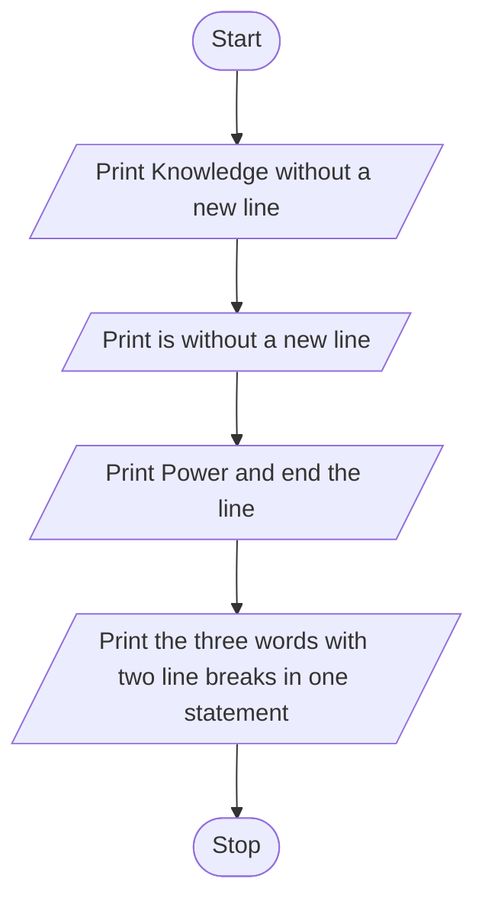
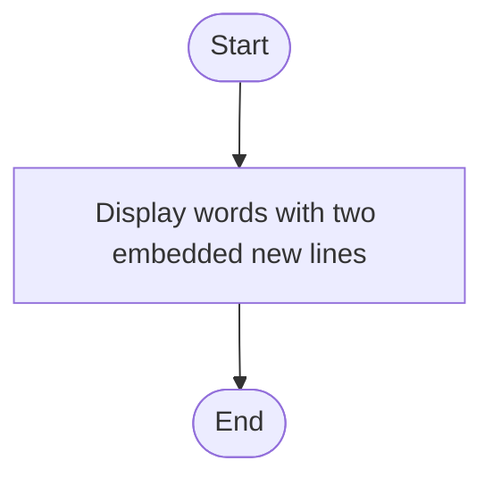
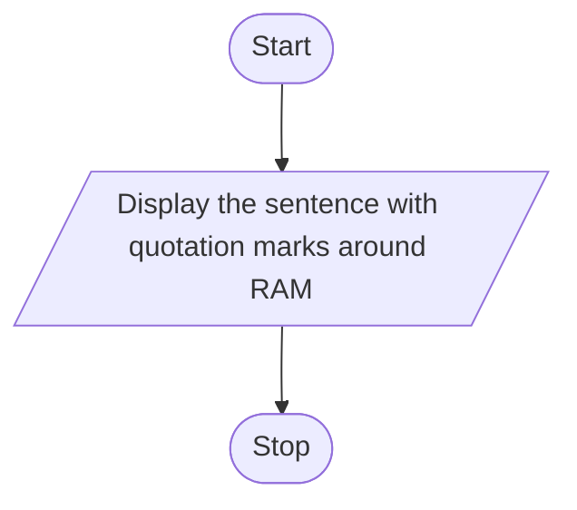
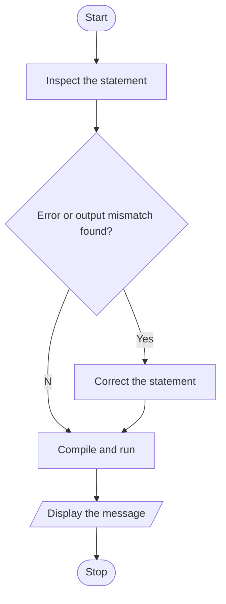
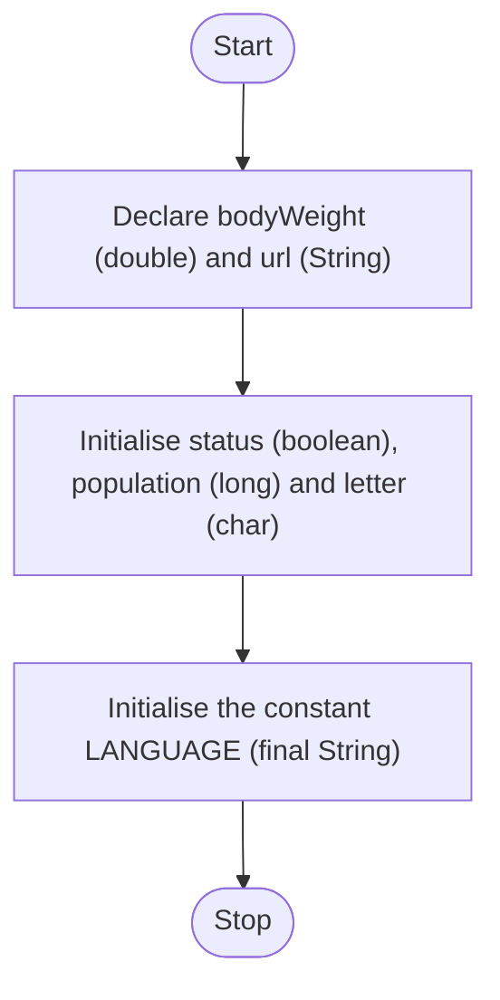
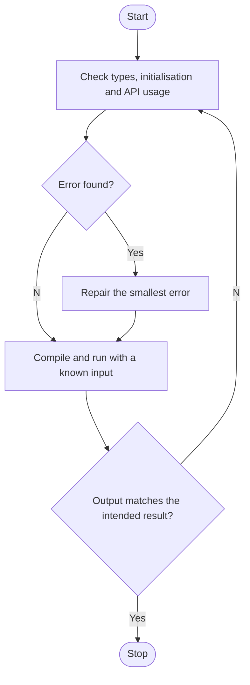
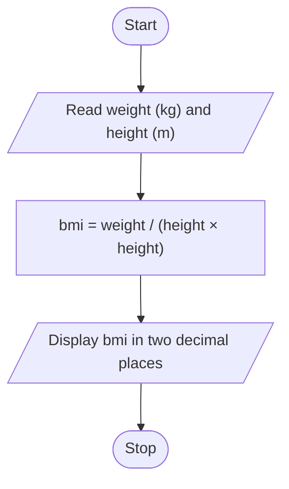
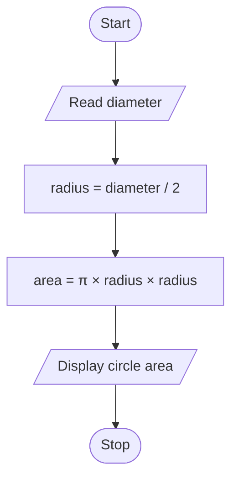

# Tutorial 02 — Answers

### Question 1

Display the phrase Knowledge is Power in two ways: on one line using three statements, and on three lines using one statement. print keeps the cursor on the same line, println ends the line, and the escape sequence \n starts a new line inside a string.

IPO model:

| Input | Process | Output |
|-------|---------|--------|
| None | Arrange the words and the line breaks | One line for part (a), three lines for part (b) |

**Part (a)**
Pseudocode:

```text
START
DISPLAY "Knowledge " without a new line
DISPLAY "is " without a new line
DISPLAY "Power" and end the line
DISPLAY "Knowledge", new line, "is", new line, "Power"
STOP
```

Flowchart:


**Part (b)**
Pseudocode:

```text
START
DISPLAY "Knowledge", newline, "is", newline, "Power"
END
```
Flowchart:



Java code:

```java
public class KnowledgeIsPower {
    public static void main(String[] args) {
	//(a)
        System.out.print("Knowledge ");
        System.out.print("is ");
        System.out.println("Power");
	//(b)
        System.out.println("Knowledge\nis\nPower");
    }
}
```

### Question 2

Print "RAM" is called Random Access Memory. including the quotation marks. A double quotation mark inside a string would end the string, so each one is written as \\" (a backslash followed by a quotation mark).

IPO model:

| Input | Process | Output |
|-------|---------|--------|
| None | Escape each literal quotation mark with a backslash | "RAM" is called Random Access Memory. |

Pseudocode:

```text
START
DISPLAY a quotation mark, RAM, a quotation mark, and the rest of the sentence
STOP
```

Flowchart:



Java code:

```java
public class QuotedRam {
    public static void main(String[] args) {
        System.out.println("\"RAM\" is called Random Access Memory.");
    }
}
```

### Question 3

Repair four output statements. (a) System.Println is wrong, because the method is println with a lowercase p. (b) The statement is missing its semicolon. \(c\) \t prints a real tab, so to print the two characters backslash and t, the backslash must be doubled as \\\t. This one compiles either way, so it is a wrong-output mistake and not a syntax error. (d) system must be System, because Java is case sensitive. The extra space before the closing bracket is harmless.

IPO model:

| Input | Process | Output |
|-------|---------|--------|
| The four output statements | Check names, punctuation and escaping; repair; compile and run | The intended messages |

Pseudocode:

```text
START
INSPECT the statement
IF a syntax error or an output mismatch is found THEN
    CORRECT the statement
END IF
COMPILE and RUN
DISPLAY the message
STOP
```

Flowchart:



Java code:

```java
public class OutputCorrections {
    public static void main(String[] args) {
        System.out.println("Hello Java!");

        System.out.println("Introduction to Java!");

        System.out.println("\\t is the horizontal tab character");

        System.out.println("Java is case sensitive!");
    }
}
```

### Question 4

Choose a suitable type for each value and declare it. double holds a body weight because it can have decimals. String holds a URL. boolean holds true or false. 2400000000 is larger than the biggest int (2147483647), so it needs long and an L at the end. char holds a single character in single quotes. final makes LANGUAGE a constant that cannot be changed.

IPO model:

| Input | Process | Output |
|-------|---------|--------|
| The six kinds of value that are requested | Choose a type and a name for each; initialise where a value is given | The declarations only, with no console output |

Pseudocode:

```text
START
DECLARE bodyWeight as double
DECLARE url as String
SET status ← true
SET population ← 2400000000
SET letter ← 'Z'
SET constant LANGUAGE ← "Java"
STOP
```

Flowchart:



Java code:

```java
public class TypesAndDeclarations {
    public static void main(String[] args) {

        double bodyWeight;

        String url;

        boolean status = true;

        long population = 2400000000L;

        char letter = 'Z';

        final String LANGUAGE = "Java";
    }
}
```

### Question 5

Repair five snippets. (a) A String cannot be stored in a double, and a final variable cannot be changed with +=, so the result is put in a new variable (compile-time error). (b) The type is String with a capital S, and text uses double quotes (compile-time error). \(c\) A variable needs a value before it is used, ++num++ is not valid, and num1 must be declared (compile-time error). (d) %f needs a double, and an int causes an IllegalFormatConversionException, so the int is cast to double (run-time error). (e) A Scanner that reads the keyboard must use System.in, not System.out, and Scanner must be imported (compile-time error).

IPO model:

| Input | Process | Output |
|-------|---------|--------|
| The five snippets, and a contact number typed in for part (e) | Repair the types, assignment, initialisation, formatting and input stream | Valid statements that give the intended values |

Pseudocode:

```text
START
REPEAT
    CHECK the snippet against type, initialisation and API rules
    IF an error is found THEN
        REPAIR the smallest error
    END IF
    COMPILE and RUN with a known input
UNTIL the output matches the intended result
STOP
```

Flowchart:



Java code:

```java
import java.util.Scanner;

public class SnippetCorrections {
    public static void main(String[] args) {

        final double AMOUNT = 32.5;
        double updatedAmount = AMOUNT + 10;
        System.out.println("The amount is " + updatedAmount);

        String chapter = "Summary";
        System.out.println(chapter);

        int num = 0;
        ++num;
        int num1 = num;
        System.out.println(num1);

        int num2 = 3000;
        System.out.printf("%4.2f%n", (double) num2);

        Scanner scanner = new Scanner(System.in);
        System.out.print("Enter your contact number: ");
        String contact = scanner.nextLine();
        System.out.println("Contact number: " + contact);
    }
}
```

### Question 6

Read the weight in kilograms and the height in metres, then calculate BMI = weight / (height × height) and show it to two decimal places. The brackets matter, because weight / height * height would just give back the weight. Locale.US makes the decimal point always a dot. The inputs are assumed to be positive numbers, and no health category is given.

IPO model:

| Input | Process | Output |
|-------|---------|--------|
| Weight in kg and height in metres | BMI = weight / (height × height) | Display BMI in two decimal places |

Pseudocode:

```text
START
READ weightKg, heightMetres
bmi ← weightKg / (heightMetres × heightMetres)
DISPLAY bmi to two decimal places
STOP
```

Flowchart:



Java code:

```java
import java.util.Scanner;
import java.util.Locale;

public class BMIcalculator {
    public static void main(String[] args) {
        Scanner scanner = new Scanner(System.in).useLocale(Locale.US);

        System.out.print("Weight (kg): ");
        double weight = scanner.nextDouble();

        System.out.print("Height (metres): ");
        double height = scanner.nextDouble();

        double bmi = weight / (height * height);
        System.out.printf(Locale.US, "BMI: %.2f%n", bmi);
    }
}
```

### Question 7

Read the diameter, halve it to get the radius, then calculate area = π × radius × radius. Math.PI is Java's built-in value of π. The answer is shown to two decimal places. The diameter is assumed to be zero or more.

IPO model:

| Input | Process | Output |
|-------|---------|--------|
| Diameter | diameter / 2 to get the radius; area = π × radius × radius | The area of the circle to two decimal places |

Pseudocode:

```text
START
READ diameter
radius ← diameter / 2
area ← PI × radius × radius
DISPLAY area
STOP
```

Flowchart:



Java code:

```java
import java.util.Scanner;
import java.util.Locale;

public class CircleArea {
    public static void main(String[] args) {
        Scanner scanner = new Scanner(System.in).useLocale(Locale.US);
        System.out.print("Diameter: ");
        double diameter = scanner.nextDouble();
        double radius = diameter / 2.0;
        double area = Math.PI * radius * radius;
        System.out.printf(Locale.US, "Circle Area: %.2f%n", area);
    }
}
```
